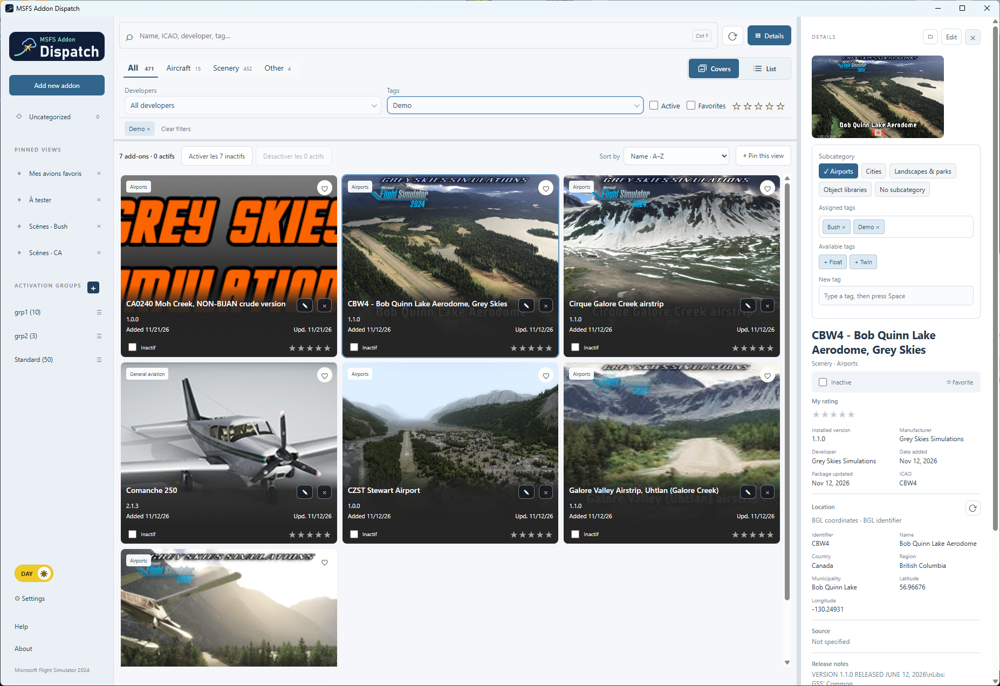

# MSFS Addon Dispatch

> **Project status:** Dispatch is functional and under active development. The current preview is **[0.9.6](https://github.com/lavoied/msfs-addon-dispatch-Releases/releases/tag/v0.9.6)**. Your ideas, suggestions and feedback are welcome! Share them through [GitHub Issues](https://github.com/lavoied/msfs-addon-dispatch-Releases/issues).

**Organize your add-ons. Find your next destination. Prepare what the simulator loads.**

MSFS Addon Dispatch is a Windows add-on manager for **Microsoft Flight Simulator 2024**. Keep your add-ons in a library outside Community, browse them as covers, a list or scenery points on an offline map, and activate the content you want for your next flight.

[**Download 0.9.6 (pre-release)**](https://github.com/lavoied/msfs-addon-dispatch-Releases/releases/tag/v0.9.6) · [User guide](https://github.com/lavoied/msfs-addon-dispatch-Releases/wiki) · [Release notes](https://github.com/lavoied/msfs-addon-dispatch-Releases/releases)

## What you can do

- **Manage an existing library.** Scan your library, including its subfolders, to discover add-ons and read package information from their manifests.
- **Import archives.** Drop ZIP, RAR or 7z files onto the application, or use **Add new addon**. Review the detected information and keep editing tags, subcategories and other details while extraction runs. Multiple archives can be queued together. Archives containing multiple MSFS packages are not supported yet.
- **Activate content without duplicating it.** Dispatch creates directory links in Community. Deactivating an add-on removes its link while keeping its source files in your library.
- **Organize your collection.** Use configurable subcategories, shared tags, favorites and star ratings. Filter by category, country, developer, tags, rating or activation status.
- **Explore your library your way.** Switch between image covers, a detailed list and an offline scenery map. Combine categories, subcategories, countries, developers, tags, ratings, favorites and activation filters to focus on exactly the add-ons you want. Save useful combinations as pinned views.
- **Work efficiently in list view.** Use standard **Ctrl-click** to select individual rows and **Shift-click** to select a range. Activate or deactivate selected add-ons together, and edit shared tags and subcategories in bulk for add-ons of the same main category. Sort columns in either direction, choose which columns to display, and resize or reorder them. Use **Up/Down** and **Space** for quick activation from the keyboard.
- **Explore scenery on an offline map.** View scenery with detected coordinates, including individual airports within multi-airport packs. Activate or deactivate add-ons using the map, including a selected area.
- **Personalize thumbnails.** Keep package images, paste an image from the clipboard or use Google Images to find one. Optional in-app image search is available with your own Serper API key. Store multiple thumbnails and select a main image.
- **Reuse your setup.** Save frequently used filters as pinned views and save active add-on sets as activation groups.
- **Find your manuals.** Use the Documents view with your library filters to find PDF guides grouped by add-on. They open in your default Windows reader and remain in their original folders.
- **Keep track of your data.** View installed versions, added and updated dates, folder sizes and available location information. Use manual database backups or enable weekly backups.
- **Stay up to date.** Dispatch can check for updates at startup and display an indicator beside **About**. You decide when to install an available update.

The interface is available in **English and French**, with **Day and Night** modes.

## Getting started

1. Download **MSFSAddonDispatch.exe** from the [0.9.6 pre-release](https://github.com/lavoied/msfs-addon-dispatch-Releases/releases/tag/v0.9.6), place it in a writable folder and run it.
2. In the welcome setup, select your **add-on library folder (required)**. Dispatch scans its subfolders, so you can keep your existing organization.
3. Optionally select your **MSFS 2024 Community folder**. Use automatic detection or browse to choose it. Without Community you can scan, import and organize your library, but you cannot activate or deactivate add-ons. Configure it later in Settings. If you choose both folders, they must be separate and not nested.
4. Run **Scan** to build the catalog. Run it again after adding or changing add-on folders manually.
5. Browse, filter and activate the add-ons you need for your flight.

Setup and the first scan do not modify or move files in your library or Community folder. Existing links with matching folder names and destinations are recognized as active automatically.

To import a new archive, drag it anywhere onto the application window or click **Add new addon**. During import you can correct the category and add a new subcategory directly in the form. A category correction made during import does not override manifest detection on future scans.

## User guide

Visit the **[User Guide Wiki](https://github.com/lavoied/msfs-addon-dispatch-Releases/wiki)** for illustrated instructions:

- [Using the sidebar, pinned views and activation groups](https://github.com/lavoied/msfs-addon-dispatch-Releases/wiki/Sidebar-guide)
- [Adding and managing thumbnails](https://github.com/lavoied/msfs-addon-dispatch-Releases/wiki/Thumbnail-management)
- [Finding PDF manuals in Documents](https://github.com/lavoied/msfs-addon-dispatch-Releases/wiki/Documents)
- [Setting up optional image search with Serper](https://github.com/lavoied/msfs-addon-dispatch-Releases/wiki/Serper-setup)

- [Settings, backups and troubleshooting](https://github.com/lavoied/msfs-addon-dispatch-Releases/wiki/Settings-backups-and-troubleshooting)

## Requirements

- **Windows 10 or Windows 11, x64.**
- **Microsoft Flight Simulator 2024.** Dispatch is developed and tested exclusively with MSFS 2024.
- **Microsoft Edge WebView2 Runtime.** It is included with Windows 11 and already installed on the vast majority of Windows 10 devices. If Dispatch reports that it is missing, install the **Evergreen WebView2 Runtime** from [Microsoft's official download page](https://developer.microsoft.com/en-us/microsoft-edge/webview2/#download-section).

The portable release does **not** require a separate .NET installation or an installed copy of 7-Zip. Internet access is used for update checks and online image searches; the scenery map works offline.

## Simulator compatibility

Dispatch has been **tested exclusively with Microsoft Flight Simulator 2024**. It is expected to work with MSFS 2020 as well, but this has not been verified. **No support is provided for MSFS 2020.**

## Why I built Dispatch

I have a background in software development and have built several applications for my organization. For a long time, I had been looking for an MSFS add-on manager that matched the way I wanted to organize and use my collection. Eventually, I decided to build my own.

Dispatch was developed entirely with the help of AI. I defined the features and workflows, guided the implementation, and tested and refined the application against my own library. AI handled the coding, while I focused on shaping a tool I wanted to use myself. Even with that assistance, this project has involved several weeks of hands-on work: defining how things should behave, testing real add-ons, tracking down problems, and refining the interface through many iterations.

What began as a personal project has grown into something I hope other flight sim enthusiasts will find useful too.

## About this repository

This repository contains the application's **public releases**, user-facing documentation and the manifest used by the update checker. It does not contain the application source code.

See the [release notes](https://github.com/lavoied/msfs-addon-dispatch-Releases/releases) for the changes in each published version.
