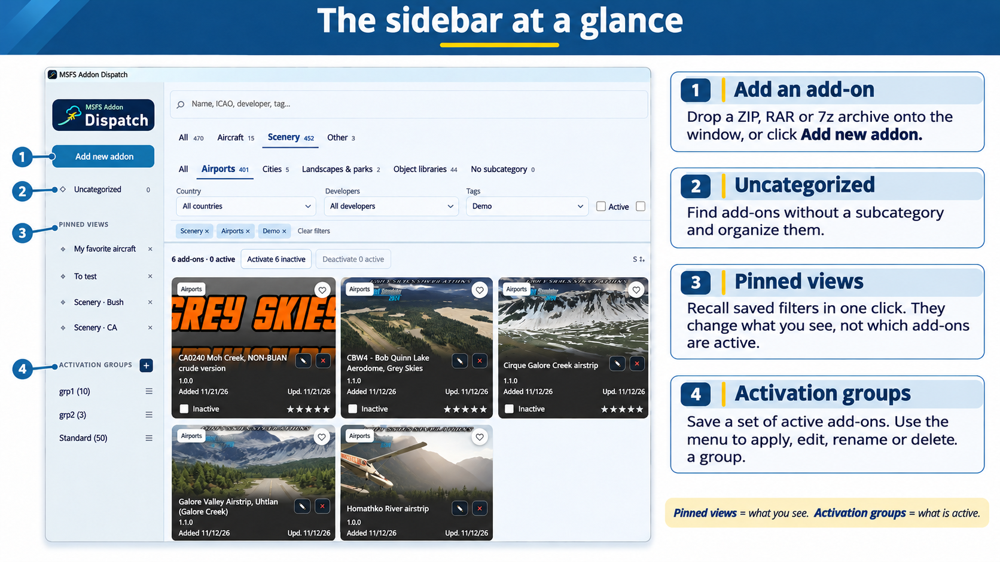

# MSFS Addon Dispatch

**Organize your add-ons. Find your next destination. Prepare what the simulator loads.**

MSFS Addon Dispatch is a Windows add-on manager for **Microsoft Flight Simulator 2024**. Keep your add-ons in a library outside Community, browse them as covers, a list or scenery points on an offline map, and activate the content you want for your next flight.

[**Download the latest version**](https://github.com/lavoied/msfs-addon-dispatch-Releases/releases/latest) · [Release notes](https://github.com/lavoied/msfs-addon-dispatch-Releases/releases)

## What you can do

- **Manage an existing library.** Scan your library, including its subfolders, to discover add-ons and read package information from their manifests.
- **Import archives.** Drop ZIP, RAR or 7z files onto the application, or use **Add new addon**. Review the detected information and keep editing tags, subcategories and other details while extraction runs. Multiple archives can be queued together. Archives containing multiple MSFS packages are not supported yet.
- **Activate content without duplicating it.** Dispatch creates directory links in Community. Deactivating an add-on removes its link while keeping its source files in your library.
- **Organize your collection.** Use configurable subcategories, shared tags, favorites and star ratings. Filter by category, country, developer, tags, rating or activation status.
- **Explore your library your way.** Switch between image covers, a detailed list and an offline scenery map. Combine categories, subcategories, countries, developers, tags, ratings, favorites and activation filters to focus on exactly the add-ons you want. Save useful combinations as pinned views.
- **Work efficiently in list view.** Use standard **Ctrl-click** to select individual rows and **Shift-click** to select a range. Activate or deactivate selected add-ons together, and edit shared tags and subcategories in bulk for add-ons of the same main category. Sort columns in either direction, choose which columns to display, and resize or reorder them. Use **Up/Down** and **Space** for quick activation from the keyboard.
- **Explore scenery on an offline map.** View scenery with detected coordinates, including individual airports within multi-airport packs. Activate or deactivate add-ons using the map, including a selected area.
- **Personalize thumbnails.** Keep package images, paste an image from the clipboard or use Google Images to find one. Optional in-app image search is available with your own Serper API key. Store multiple thumbnails and select a main image.
- **Reuse your setup.** Save frequently used filters as pinned views and save active add-on sets as activation groups.
- **Keep track of your data.** View installed versions, added and updated dates, folder sizes and available location information. Use manual database backups or enable weekly backups.
- **Stay up to date.** Dispatch can check for updates at startup and display an indicator beside **About**. You decide when to install an available update.

The interface is available in **English and French**, with **Day and Night** modes.

## Getting started

1. Download **MSFSAddonDispatch.exe** from the [latest release](https://github.com/lavoied/msfs-addon-dispatch-Releases/releases/latest), place it in a writable folder and run it.
2. In the welcome setup, select your **MSFS 2024 Community folder**. Use automatic detection if available, then verify the selected path.
3. Select your **add-on library folder**. Use a separate folder from Community; your existing subfolder organization can stay in place.
4. Run **Scan** to build the catalog. Run it again after adding or changing add-on folders manually.
5. Browse, filter and activate the add-ons you need for your flight.

To import a new archive, drag it anywhere onto the application window or click **Add new addon**.

## Understanding the sidebar



### Add new addon

Open the import window with the button, or drop one or more ZIP, RAR or 7z archives onto Dispatch. Each import entry lets you review the add-on information and assign tags and a subcategory.

### Uncategorized

Find add-ons that do not have a subcategory yet. Select an add-on and use the Details panel to classify it.

### Pinned views

A pinned view remembers a set of filters, such as scenery in a particular country or add-ons with a specific tag. Configure your filters, choose **Pin view**, and give the view a name. Click it later to restore those criteria.

Pinned views change **what you see**, not which add-ons are active. Removing a pinned view does not delete its add-ons.

### Activation groups

An activation group stores a set of add-ons to use together.

1. Activate the add-ons you want to include.
2. Click **+** beside **Activation Groups** and enter a name.
3. Use the menu beside the group to **Apply**, **Edit**, **Rename** or **Delete** it.

**Apply** activates the group's members and deactivates other add-ons in the configured library. Clicking a group name alone does not apply it. **Edit** lets you change its members, then save or cancel. Deleting a group does not delete the add-on files.

> **Pinned views save what you want to see. Activation groups save what you want to activate.**

## Optional thumbnail search with Serper

Dispatch can search for thumbnail images directly in the application using your own **Serper API key**. This is optional: importing, organizing, activating add-ons and using the offline map do not require a Serper account.

1. Create an account at [serper.dev](https://serper.dev/) and obtain your API key from your account dashboard.
2. Open **Settings → Image search** in Dispatch.
3. Paste the key into **Serper API key**, choose **Images per search** (5 by default, up to 20), and save your settings.
4. Select an add-on, open **Details**, enter edit mode and click **Add Thumbnail via Serper API**.
5. Pick an image from the search results to add it to the add-on's gallery. Request the next set of results if you need more choices.

Image search uses the add-on's name and developer to help find relevant results. You can keep multiple thumbnails, remove images and choose the main thumbnail. Clipboard paste and opening Google Images remain available alternatives.

Keep your API key private. Requests use your own Serper account and its available credits; account limits and pricing are managed by Serper.

## Requirements

- **Windows 10 or Windows 11, x64.**
- **Microsoft Flight Simulator 2024.** Dispatch is developed and tested exclusively with MSFS 2024.
- **Microsoft Edge WebView2 Runtime.** It is included with Windows 11 and already installed on the vast majority of Windows 10 devices. If Dispatch reports that it is missing, install the **Evergreen WebView2 Runtime** from [Microsoft's official download page](https://developer.microsoft.com/en-us/microsoft-edge/webview2/#download-section).

The portable release does **not** require a separate .NET installation or an installed copy of 7-Zip. Internet access is used for update checks and online image searches; the scenery map works offline.

## Simulator compatibility

Dispatch has been **tested exclusively with Microsoft Flight Simulator 2024**. It is expected to work with MSFS 2020 as well, but this has not been verified. **No support is provided for MSFS 2020.**

## Why I built Dispatch

I have a background in software development and have built several applications for my organization. For a long time, I had been looking for an MSFS add-on manager that matched the way I wanted to organize and use my collection. Eventually, I decided to build my own.

Dispatch was developed entirely with the help of AI. I defined the features and workflows, guided the implementation, and tested and refined the application against my own library. AI handled the coding, while I focused on shaping a tool I wanted to use myself.

What began as a personal project has grown into something I hope other flight sim enthusiasts will find useful too.

## Settings, backups and troubleshooting

Settings, the SQLite catalog, custom thumbnails, backups and diagnostic logs are stored in:

```text
%LOCALAPPDATA%\MSFSAddonDispatch
```

The executable is portable; its user data is stored in LocalAppData rather than beside the executable. Updates preserve that data.

In **Settings**, you can create a database backup, open the backup folder or schedule a restore. Diagnostic logs are available through **Open logs folder** and are retained for 14 days with size-based rotation.

## About this repository

This repository contains the application's **public releases**, user-facing documentation and the manifest used by the update checker. It does not contain the application source code.

See the [release notes](https://github.com/lavoied/msfs-addon-dispatch-Releases/releases) for the changes in each published version.

